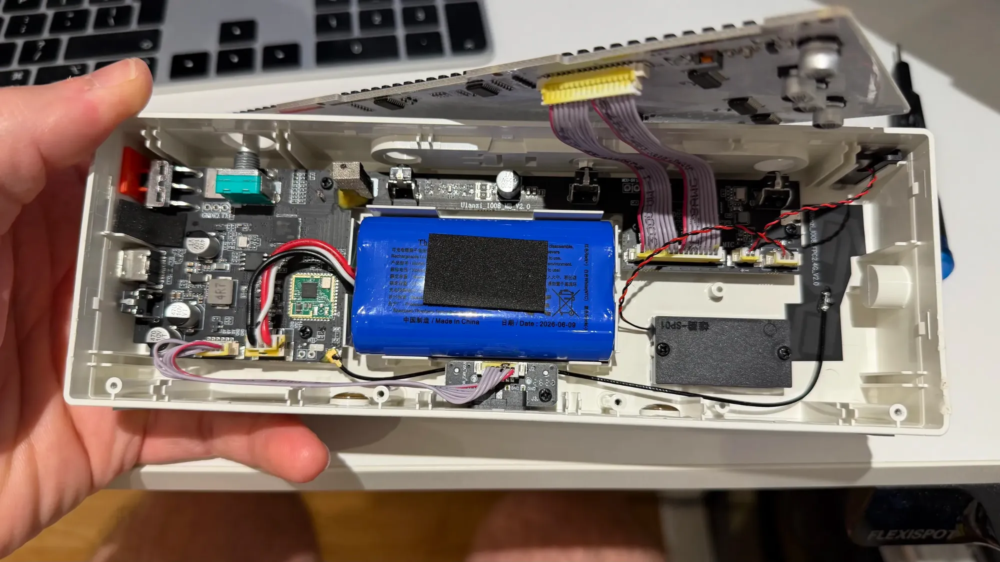
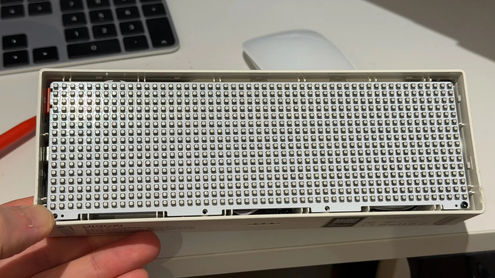
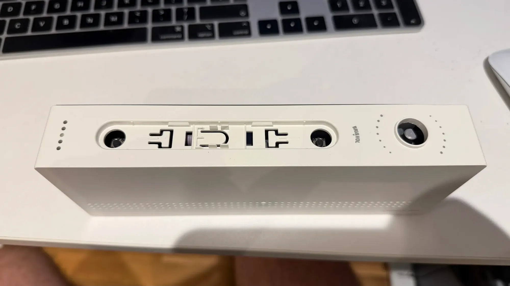

# TEARDOWN.md — inside a TC002, photographed

Everything else in these notes was read off a running unit: `/proc`, `/sys`, the device tree and
strings in the app. This is the other half: what's inside the case. The unit was opened from the
front and photographed, and its firmware matches *unit B* in [`FINGERPRINTS.md`](FINGERPRINTS.md).

There are two kinds of claim below, and they're kept apart on purpose:

- **Printed**: silkscreen, part markings and labels you can read in the photo.
- *Inferred*: what a part probably is, based on where it sits and what the software has already
  established. None of these were checked with a meter.

## Opening it

You get in through the front, in two steps. This comes from the owner's experience of opening this
unit, not from the photos:

1. **The front display cover is glued on** with a film of double-sided tape, so it has to be
   prised off; it doesn't unclip. The photo shows it part-way off at one end.
2. Behind it is the **LED diffuser panel**, a black egg-crate louvre with one cell per LED that
   keeps each pixel's light in its own square. It's held in by **four screws at the bottom**.
   Once those are out, the rest of the assembly pops out of the case.

The inside of the cover is printed **`Pixbar`**. One end of the case has the **1/4-inch tripod
thread** (*spec*), and the long face next to it (*the base, as the clock stands*) has a grey
window and the regulatory label:

| On the label | What it is |
|---|---|
| **`…D: 2BTBM-TC002`** | *The FCC ID*: grantee `2BTBM`, product `TC002`. The start of the line is out of frame. FCC filings are public and usually include the manufacturer's own internal photos. |
| **`…T ID: 26J44B0TM765`** | The start is out of frame; *probably the Chinese CMIIT ID*. |
| **`R 214-260250`** | Next to the Japanese giteki mark: the radio equipment certification number. |
| **RoHS** and the crossed-out wheelie bin | The usual European marks. |

Once the assembly is out, the LED panel lifts away on its ribbons. The rest of the photos show the
tray behind it.

## The whole thing

The LED panel sits at the front of the tray. It lifts away on **two grey ribbon cables**, and
everything else lives in the tray behind it. From left to right in the photo: the SoC end of the
main board, the battery, the other end of the main board with the panel, mic and speaker
connectors, then the speaker box and the flexible Wi-Fi antenna. The main board
(**`Ulanzi_I008_MB_V2.0`**) runs along the top edge of the tray; *it looks like one L-shaped
board*, wider at the SoC end.

## The main board, SoC end

| Part | What's there |
|---|---|
| SoC | **SigmaStar `SSD210`** (printed: `SSD210`, `AV52D03B`, `2529I`, `ARM`). The software only ever said `ssd21x`. The 64 MB of in-package DRAM in the README's [hardware](README.md#hardware) table matches the SSD210. |
| Serial header | **Three through-hole pads silkscreened `GND RX TX`**, unpopulated, right next to the SoC. *Very likely the kernel console on `ttyS0` at 115200*, which the README had down as "whether pads are reachable was not checked". Nobody has connected to it yet. |
| Next to the SoC | An 8-pin package (*probably the 32 MiB SPI NOR flash*; the markings aren't legible here) and a crystal. |
| Wi-Fi / Bluetooth | A **green castellated module** with a U.FL lead to the antenna on the far right of the tray. Its markings aren't legible; the software identifies it as an **AICSemi AIC8800DC**. |
| Battery connector | **3-pin, `GND` / `NTC` / `BAT+`**, matching the pack's own label: red (+), white (NTC), black (−). |
| 6-pin header | **`5V 5V 5V GND GND GND`**, with a ribbon to the small board at the bottom edge. |
| USB-C | At the left edge, with the supply's bulk capacitors (`470 µF 10 V`) and a `4R7` inductor next to it. |
| The knob | The teal **rotary encoder** with its threaded shaft (*the `BRI&VOL` knob*; GPIO 10 / 11 in the README). |
| Slide switch | A **red three-pin slide switch** right at the edge; *the power switch*. |

The battery is a single blue-wrapped pack **made by Shenzhen Thanksun Technology, dated
2026-06-09**, with three leads. Its capacity is hidden under a foam pad; Ulanzi's *spec* is 3.7 V,
3600 mAh.

The small board at the bottom edge is **`I008_ZJB_V2.0`** (date code `2624`). `J2` takes the
six-wire ribbon from the main board's 5 V / ground header, `J3` faces out through the base, and
there are two `GND` pads between them. *It's probably the charging dock's contacts.* The README
measured the dock showing up on the same `vin` as USB-C, which is what you'd expect from a board
wired straight to the 5 V rail.

## The main board, panel end

| Part | What's there |
|---|---|
| Panel connector | A wide **header marked pin 1** and labelled `LED`, carrying both grey ribbons to the panel. |
| Mic / speaker | Two 2-pin connectors, **`MIC`** and **`SPK`**, each marked `+ −`, with twisted red/black pairs. |
| Pads | **`MCU-5V`** test pads above the ribbons. |
| The chip here | A QFN with its own crystal, next to the `LED` header and the `MCU-5V` pads; *the pixel MCU* that the README describes sitting between the SoC and the LEDs. |
| Speaker | A sealed black box marked **`SP01`**, screwed to the tray. |
| Microphone | *The small part in the top-right corner of the tray*, on the twisted pair that ends at `MIC`. |
| Antenna | A flexible PCB antenna, **`Ulanzi_I008_FPC2.4G_V2.0`**, stuck to the case wall and fed by the U.FL lead from the Wi-Fi module. |

The mic being wired to this end, next to the MCU, fits what the software showed: the stock app
reads the mic **level** from the MCU (`queryMicValue`), not from the SoC's audio input.

## The LED panel

This is the panel with the front cover and the diffuser panel off: the **52 × 16 grid of RGB
LEDs** on a white board. The LED drivers are on the back (you can see them in the overview photo).
[`LED-SPI.md`](LED-SPI.md) covers how it's driven.

## The top

This is the top with the button bar's cap off. The **left and right buttons' tact switches** show
through their holes, *the middle button is the sprung tab between them*, and the **`BRI&VOL`** knob
is on the right. That matches the README: three buttons across the top plus the knob's own push,
and nothing else.
